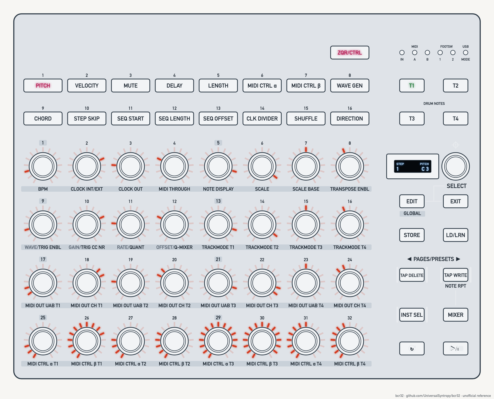
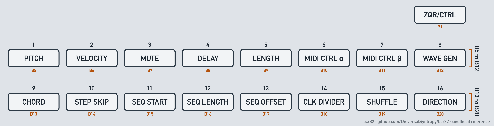
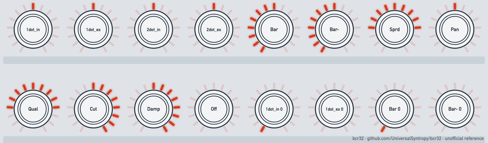

# bcr32

Unofficial documentation and tools for the Behringer BCR32 MIDI controller and step sequencer.

<picture>
  <source media="(prefers-color-scheme: dark)" srcset="docs/assets/figures/fig-3-1-hero-dark.png">
  
</picture>

**Figure 3-1.** The BCR32 top panel with PITCH selected. [List of figures](docs/manual/figures.md)

The BCR32 combines two devices: a 4-track, 32-step sequencer (the "Zaquencer", with MIDI, USB-MIDI and CV/gate outputs) and a 32-encoder MIDI controller. This repo restructures the official manual into a quick, searchable reference, and adds setup guides and tools as they're written.

> **Note:** This project is not affiliated with or endorsed by Behringer or Music Tribe. Behringer and Music Tribe are trademarks of their owners.
>
> **Warning:** This is a reference guide only. It makes no claim of accuracy. You use it at your own risk. The authors take no responsibility for damage to hardware or software, or for any issue or loss that comes from its use. Read the [disclaimer](DISCLAIMER.md). Back up your presets before you try any step.

## Start here

| If you want to | Read |
| --- | --- |
| Look up a control, menu or procedure | [BCR32 manual](docs/manual/README.md) |
| Connect the BCR32 to Ableton Live | [Connect to Ableton Live](docs/guides/connect-to-ableton-live.md) |
| Fix a problem | [Troubleshooting](docs/guides/troubleshooting.md) |
| See what is planned | [Project plan](docs/project/plan.md) |
| See where the work is | [Playbook and live status](docs/project/playbook.md) |
| See every document | [Documentation index](docs/README.md) |
| Contact Behringer or find official links | [Official sources and support](docs/guides/official-sources-and-support.md) |
| Read the terms of use | [Disclaimer](DISCLAIMER.md) |
| Contribute or edit docs | [CONTRIBUTING.md](CONTRIBUTING.md) |

## Figures in the manual

The manual explains each control with drawings. Every figure has a number, and the [list of figures](docs/manual/figures.md) links to each one. Two examples:

<picture>
  <source media="(prefers-color-scheme: dark)" srcset="docs/assets/figures/fig-3-3-parameter-buttons-dark.png">
  
</picture>

**Figure 3-3.** Parameter buttons B5 to B20 and the mode button B1. [List of figures](docs/manual/figures.md)

<picture>
  <source media="(prefers-color-scheme: dark)" srcset="docs/assets/figures/fig-8-1-ring-styles-dark.png">
  
</picture>

**Figure 8-1.** LED styles around the knobs, at half value and at zero (model, unverified on the unit). [List of figures](docs/manual/figures.md)

## Repository layout

| Path | Contents |
| --- | --- |
| `docs/reference/` | Structured reference built from the official manual |
| `docs/guides/` | Task-based guides: setup, DAW connection, troubleshooting |
| `docs/project/` | Project plan, architecture note, decision log |
| `tools/` | Check tools: privacy, documentation standard, manual coverage, generated tables |
| `reference/` | Local copy of the official PDF manual; PDFs are git-ignored |
| `local/` | Your own setup notes; git-ignored apart from its README |
| `llms.txt` | Index of the docs for LLM tools |

## Status

- **Documentation:** draft. The reference covers the full English section of the official manual V2.0. Guides marked "unverified" haven't been tested on a unit yet.
- **Firmware covered:** the official manual doesn't state a firmware version. Facts marked verified were tested on firmware 1.0.3.
- **Tools:** four check tools; see the [tools index](tools/README.md).

## Official sources

- **User manual:** Behringer BCR32 User Manual V2.0, dated 2026-04-06. Download it from the product page on behringer.com and save it in `reference/`.
- **Editor and firmware updates:** the Control Tribe app from Behringer.
- **Product page and support:** see [Official sources and support](docs/guides/official-sources-and-support.md). Music Tribe's open-source repository for the BCR32 (demo firmware, schematic, interface documents) is [MusicTribeOpenSource/0715-AAW](https://github.com/MusicTribeOpenSource/0715-AAW).

## License

- **Documentation** (`docs/`, `README.md`, `llms.txt` and other prose): [Creative Commons Attribution 4.0](LICENSE-docs) (CC BY 4.0). Reuse it with credit to "bcr32 contributors".
- **Code** (`tools/`, `packages/`) and **device data** (`data/`): [MIT](LICENSE).
- **Figures** (`docs/assets/figures/`): © bcr32 contributors. All rights reserved. Do not copy or reuse them without permission. This applies in place of the documentation licence.
- **Official Behringer material** isn't covered by these licenses and isn't included in the repo.
