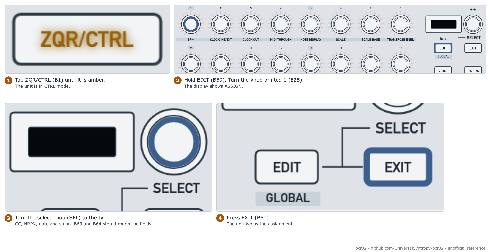
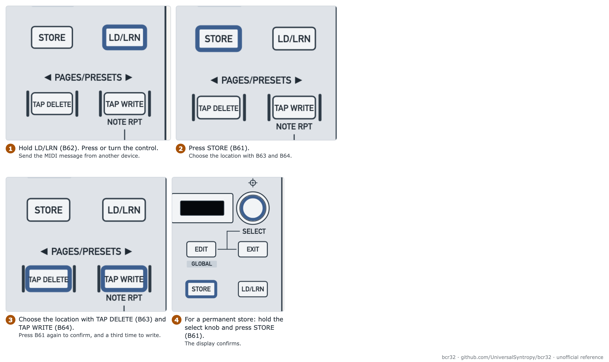

# Assign controls in CTRL mode

Goal: make a control send the MIDI message that you choose, and keep it in a preset.

| Item | Value |
| --- | --- |
| Mode | CTRL (button printed ZQR/CTRL, B1, amber) |
| Time | 10 minutes |
| Firmware tested | 1.0.3. The message forms are verified |

## Figures

<picture>
  <source media="(prefers-color-scheme: dark)" srcset="../assets/figures/fig-G8-1-assign-control-dark.png">
  
</picture>

**Figure G8-1.** Assign a control in CTRL mode. [List of figures](../manual/figures.md)

[Figure 3-1](../manual/03-top-panel-control-map.md#35-diagram-of-the-top-panel) shows the panel. You can assign these controls: the buttons printed 1 to 16 (B5 to B20), B21 to B24 and B65 to B68. You can also assign the knobs printed 1 to 32 (E25 to E56) and the two footswitches.

## Step 1: enter CTRL mode

1. Tap the button printed ZQR/CTRL (B1) until it is amber.

> **Warning:** In ZAQ mode, EDIT (B59) opens the Global page. Hold EDIT only in CTRL mode. In CTRL mode the display shows "ASSIGN".

## Step 2: assign a message

1. Hold the key printed EDIT (B59). Turn or push a knob, or press a button.
2. Turn the select knob (SEL) to the message type.
3. Press the key printed TAP DELETE (B63) or TAP WRITE (B64) to step through the fields. Turn SEL to set each value.
4. Press the key printed EXIT (B60) to finish.

| Type | Knob | Button |
| --- | --- | --- |
| Off | yes | yes |
| PC (program change) | yes | yes |
| CC (control change) | yes | yes |
| NRPN | yes | yes |
| PB (pitch bend) | yes | no |
| Note | no | yes |
| AT (aftertouch) | yes | yes |
| GS | yes | yes |
| MMC | no | yes |

The fields for each type are in [Setup fields per type](../manual/08-controller.md#84-setup-fields-per-type).

**Example:** make the knob printed 1 (E25) send CC 20 on channel 1, from 0 to 127. Choose CC. Set channel 1, controller 20, minimum 0, maximum 127, mode Absolute.

## Step 3: use Learn instead

<picture>
  <source media="(prefers-color-scheme: dark)" srcset="../assets/figures/fig-G8-2-learn-and-store-dark.png">
  
</picture>

**Figure G8-2.** Learn a control, then store the result. [List of figures](../manual/figures.md)

1. Hold the key printed LD/LRN (B62). Press or turn the control.
2. Send the MIDI message from another device on DIN or USB.
3. Fine-tune with EDIT (B59) if needed.

## Step 4: store a preset

1. Press the key printed STORE (B61).
2. Choose the location with B63 and B64.
3. Press B61 again to confirm. Press B61 a third time to write. This is the temporary store.
4. For a permanent store, hold the select knob (SEL) and press B61.

To load a preset, choose the location with B63 and B64. It loads at once.

> **Warning:** Do not store over presets 1 to 4 or preset 64 unless you have a backup. See [back up your BCR32](back-up-your-bcr32.md).

## Check what the unit sends

Use a MIDI monitor on the port `BCR-32 CTRL`. These forms were seen on firmware 1.0.3:

| Setting | What the unit sends |
| --- | --- |
| CC, absolute | The CC value. The first click gives 1 |
| NRPN | CC 99 (high), CC 98 (low), then CC 6 (data) |
| Button, toggle off | The value on press, and the minimum on release |
| Button, toggle on | The value on press only |
| Button, increment | The step value |
| Button, PC | A program change with the number as written |

The full list is in [findings](../reference/capture-findings.md#test-preset-a-live-output-2026-11-13-verified-on-firmware-103).

## Related

- [Controller](../manual/08-controller.md)
- [Choose encoder modes and LED rings](choose-encoder-modes-and-led-rings.md)

**Next step:** Choose the knob mode for your DAW.
