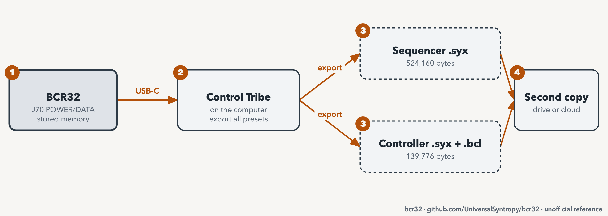

# Back up your BCR32

Goal: save a copy of the memory of your unit before you change settings, update the firmware or reset the unit.

| Item | Value |
| --- | --- |
| Needs | A computer, a USB-C cable on J70, the Control Tribe app |
| Time | 10 minutes |
| Firmware tested | 1.0.3 (backup verified, restore unverified) |

> **Warning:** Take a backup before a factory restore, a firmware update or an erase. These actions can remove all data. See the [disclaimer](../../DISCLAIMER.md).

## What the unit holds

| Memory | What it holds | Size of the file |
| --- | --- | --- |
| Sequencer | Patterns, pages and the global settings of the sequencer. The clock source is part of it | 1,920 messages, 524,160 bytes |
| Controller | 64 controller presets | 512 messages, 139,776 bytes |
| One preset | The preset that is current now | 2,730 bytes (sequencer) or 10 messages (controller) |

The sequencer keeps a pattern in working memory until you store it. A backup holds only what is stored. See [save, load and chain patterns](save-load-and-chain-patterns.md).

## Back up with Control Tribe

<picture>
  <source media="(prefers-color-scheme: dark)" srcset="../assets/figures/fig-G1-1-backup-flow-dark.png">
  
</picture>

**Figure G1-1.** Back up: from the unit to two copies of the files. [List of figures](../manual/figures.md)

Verified on firmware 1.0.3, Control Tribe 1.12.4, macOS.

1. Connect J70 (POWER/DATA) to the computer. Wait until the unit starts.
2. Open Control Tribe. Wait until it shows the unit.
3. Open the export function for the sequencer. Choose **All Presets**. Save the file.
4. Open the export function for the controller. Choose **All Presets**. Save the file.
5. Look at the saved files. Each export gives a `.syx` file. The controller export also gives a `.bcl` text file.

**Expect:** The `.syx` file for the sequencer is 524,160 bytes. The `.syx` file for the controller is 139,776 bytes.

> **Note:** Menu names can differ between Control Tribe versions. Choose the export of **all** presets, not **Current Preset**. The current-preset file does not fit into the all-presets file.

## Check the files

1. Export a second time, without any change on the unit.
2. Compare the two files. They must be identical.
3. Copy the files to a second place, such as a drive or cloud storage.
4. Mark the files read-only.

**Why this works:** Two exports of unchanged memory gave identical files on our unit. This is a good test that the export read the unit.

## Do not use the panel export

The unit has a panel export: STORE (B61), then hold the select knob (SEL) and push the knob printed 1 (E25). The display shows "export mode". Our unit then sent nothing on USB, in three tries. Use the editor instead. See [known issue K1](../manual/15-known-issues.md).

> **Warning:** The knob printed 25 (E49) opens the erase menu. Never push it by mistake. Use the printed number and the ID together.

## Restore

**Unverified.** We have not restored a full backup on a unit.

- **One controller preset:** a `.bcl` text file can be imported with Control Tribe. This is verified for test presets. See [edit controller presets as text](edit-controller-presets-as-text.md).
- **Full restore:** the unit has a SysEx import menu (STORE, then hold SEL and push the knob printed 9, E33). The manual does not say what the unit does with a file it cannot read. Send only the unit's own, unchanged export.
- **After a reset or a failed update:** follow the [recovery runbook](recovery-runbook.md), from the least invasive step.

## Related

- [Global, sync, memory and maintenance](../manual/09-global-sync-memory-and-maintenance.md)
- [SysEx dump format](../reference/sysex-dump-format.md) (how the file is built)

**Next step:** Keep the two copies. Then try a change that you can undo.
