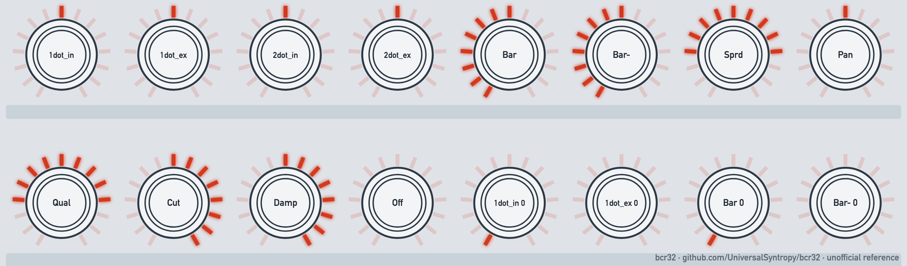

# Choose encoder modes and LED rings

Goal: pick the knob mode that matches your DAW or synth, and a ring style that shows the value well.

| Item | Value |
| --- | --- |
| Mode | CTRL |
| Time | 10 minutes |
| Firmware tested | 1.0.3. The messages and the stored LED codes are verified. The ring pictures are a model |

## Step 1: pick the knob mode

Set the mode in the setup of the control. See [assign controls in CTRL mode](assign-controls-in-ctrl-mode.md).

| Mode | Use when | What one click clockwise sends (verified) |
| --- | --- | --- |
| Absolute | The target needs the value itself | The value rises from the minimum. The first click gives 1 |
| ABS_14 (A14) | The target needs fine steps (14 bit) | CC n (high part), then CC n+32 (low part). The low part steps by 32 per click |
| REL1 | The target takes a two's complement step | `01` |
| REL2 | The target takes an offset of 64 | `41` (65). The manual gives 63 for counter-clockwise (untested) |
| REL3 | The target takes sign and magnitude | `01` |
| R1_14, R2_14, R3_14 | Relative on a 14-bit pair | CC n = 0, then CC n+32 = `01` for the first form |
| INC/DEC | The target takes up and down steps (NRPN, GS) | CC 96 with `01` per click, for NRPN |

> **Note:** We tested only the clockwise side. For REL1 and REL3 the manual lists other values, such as 65 clockwise for REL3. Our unit sent `01` clockwise for both. Test the counter-clockwise side before you rely on it. See [source errors and gaps](../manual/12-source-errors-and-gaps.md).
>
> The unit rejected a CC with INC/DEC. INC/DEC works with NRPN. The unit stored a relative-2 or relative-3 14-bit line as plain relative-2 or relative-3.

## Step 2: match the DAW

A DAW names the relative modes in its own way. Use the one that treats the value from the table as "one step up".

| The unit sends for one click up | Look for a DAW mode that reads |
| --- | --- |
| `01` (REL1) | Two's complement, or "signed", where 1 is up |
| `41` (REL2) | Offset or binary offset, where 64 is zero and 65 is up |
| `01` for up (REL3) | Sign and magnitude, where 1 is up |

Check the result in your DAW. Turn the knob slowly in both directions. If the value goes the wrong way, change the mode. See [map the BCR32 in your DAW](map-the-bcr32-in-your-daw.md).

## Step 3: pick a ring style

<picture>
  <source media="(prefers-color-scheme: dark)" srcset="../assets/figures/fig-8-1-ring-styles-dark.png">
  
</picture>

**Figure 8-1.** LED styles around the knobs, at half value and at zero (model, unverified on the unit). [List of figures](../manual/figures.md)

The ring shows 15 LEDs. The style is set in the setup of the control. The editor and the text file use different names.

| Display name | Text file word | Stored code | Shows |
| --- | --- | --- | --- |
| Off | `off` | 0 | Nothing |
| 1dot_in | `1dot` | 1 | One LED at the value |
| 1dot_ex | `1dot/off` | 2 | One LED, dark at zero |
| 2dot_in | `12dot` | 3 | Two LEDs between steps |
| 2dot_ex | `12dot/off` | 4 | Two LEDs, dark at zero |
| Bar | `bar` | 5 | A bar from the start to the value |
| Bar- | `bar/off` | 6 | A bar, dark at zero |
| Sprd | `spread` | 7 | A bar out from the centre |
| Pan | `pan` | 8 | From the centre to the value (the manual gives the same text as Sprd) |
| Qual | `qual` | 9 | All LEDs on at the minimum. They go out toward the centre |
| Cut | `cut` | A | All LEDs on at the minimum. They go out one by one |
| Damp | `damp` | B | One LED on at the minimum. More light up |

**Figure:** [Figure 8-1](../manual/08-controller.md#842-led-options) shows the styles at half value and at zero. It is a model. It is not a recording of the unit.

**Verified:** The codes 0 to B are stored as shown. The unit rejected `pan/off`, `spread/off` and `qual/off`.

## Step 4: set the start value and the display

The ring start position comes from the default value. It is stored as twice the value plus 1. The setting **Display** on or off shows the value on the screen when you turn the knob.

## Related

- [Setup fields per type](../manual/08-controller.md#84-setup-fields-per-type)
- [BCL preset text format](../reference/bcl-preset-text-format.md)

**Next step:** Map the controls in your DAW.
