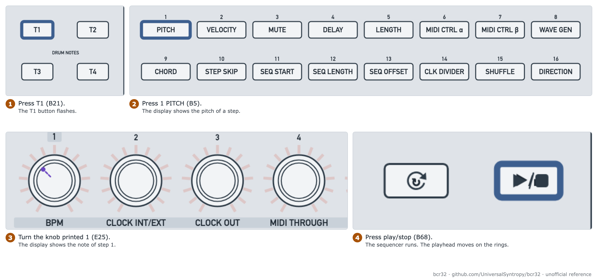

# Enter and play your first pattern

Goal: enter a short note pattern on track 1, hear it and save it.

| Item | Value |
| --- | --- |
| Mode | ZAQ (button printed ZQR/CTRL, B1, pink) |
| Needs | A synth on CV and gate, or on MIDI |
| Time | 15 minutes |
| Firmware tested | 1.0.3. Display text is verified. Playing is unverified |

> **Note:** On our unit track 1 was in drum mode. A drum track works in a different way. For this guide the track must be in chord mode. See Step 1.

## Figures

<picture>
  <source media="(prefers-color-scheme: dark)" srcset="../assets/figures/fig-G4-1-first-pattern-dark.png">
  
</picture>

**Figure G4-1.** Enter and play a first pattern: four key actions. [List of figures](../manual/figures.md)

The drawings of the panel are [Figure 3-3](../manual/03-top-panel-control-map.md#31-left-block-parameter-buttons-b5b20) (parameter buttons) and [Figure 3-4](../manual/03-top-panel-control-map.md#33-encoder-grid-e25e56) (knobs).

## Step 1: check the mode and the track type

1. Look at the button printed ZQR/CTRL (B1). It must be pink. If it is amber, tap it once.
2. Press the key printed EDIT (B59). The ZAQ Global page opens.
3. Turn the knob printed 13 TRACKMODE T1 (E37). The display shows "POLY MODE" with CHORD or DRUM. Set CHORD.
4. Press the key printed EXIT (B60).

## Step 2: connect the synth

Choose one route. See [use CV and gate with a synth](use-cv-and-gate-with-a-synth.md) and [set MIDI ports, channels and routing](set-midi-ports-channels-and-routing.md).

| Route | Connect |
| --- | --- |
| CV and gate | J78 (CV 1) to the pitch input. J79 (GATE 1) to the gate input |
| MIDI | J72 (MIDI OUT A) to the synth MIDI IN. Set the track port and channel |

## Step 3: enter the notes

1. Press the key printed T1 (B21). The T1 button flashes.
2. Press the button printed 1 PITCH (B5). The display shows the pitch of a step.
3. Turn the knob printed 1 (E25). The display shows the note of step 1. Every step starts at C3.
4. Turn the knobs printed 2 to 8 (E26 to E32) for steps 2 to 8.
5. Press the button printed 3 MUTE (B7). Turn the knob of each step that you do not want. The ring of a muted step goes dark.

**Expect:** The display shows one note for each knob that you turn.

> **Note:** The manual says "toggle" for mute and skip. It does not say if you turn or push the knob. Try both.

**Tip:** Hold the button printed 1 PITCH (B5) and turn one knob. This moves all 32 steps together. Use it to set the key.

## Step 4: shape the pattern

Press a parameter button, then turn the knobs. The change works while the pattern plays.

| Press (printed, ID) | Turn the knobs to change | Range |
| --- | --- | --- |
| 2 VELOCITY (B6) | The velocity of each step | 0 to 127 |
| 5 LENGTH (B9) | The note length of each step | 96 to 4b |
| 4 DELAY (B8) | The timing of each step | -5 to +5 |
| 12 SEQ LENGTH (B16) | The last step. Knob 1 (E25) is step 1 | 1 to 32 |

**Verified on firmware 1.0.3:** In LENGTH mode the display shows "STEP n LENGTH value". One notch clockwise from 32 gives t16. Holding LENGTH (B9) and turning one knob changes all steps. One notch back restores them.

## Step 5: play

1. Press the key printed play/stop (B68). The sequencer runs. The playhead moves on the rings.
2. Press B68 again to stop.

If the clock source is external, the start comes from the DAW. See [sync the sequencer to a DAW or hardware](sync-the-sequencer-to-a-daw-or-hardware.md).

## Step 6: save

> **Warning:** The unit loses a pattern at power-off if you do not store it. Nothing loads at power-up.

See [save, load and chain patterns](save-load-and-chain-patterns.md).

## Related

- [Sequencer per-track parameters](../manual/05-sequencer-per-track-parameters.md)
- [Sequencer procedures](../manual/07-sequencer-procedures.md)

**Next step:** Save the pattern.
