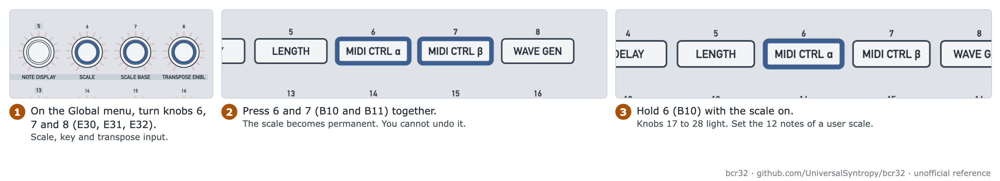

# Lock notes to a scale and transpose

Goal: keep every note in a key, and change the key while the pattern plays.

| Item | Value |
| --- | --- |
| Mode | ZAQ |
| Time | 15 minutes |
| Firmware tested | 1.0.3 for the option lists. The behaviour is unverified |

## The settings

All three are on the ZAQ Global page. Press the key printed EDIT (B59) to open it. Press EXIT (B60) to leave.

| Setting | Knob (printed, ID) | Values |
| --- | --- | --- |
| Scale | 6 SCALE (E30) | OFF (seen), Major, Minor, Dorian and more. See the manual |
| Scale base | 7 SCALE BASE (E31) | C (seen) to B |
| Transpose enable | 8 TRANSPOSE ENBL (E32) | OFF, CH 1 to CH 16, TRACK, then 1-4, 2-5 up to 13-16 |

## Step 1: choose a scale

<picture>
  <source media="(prefers-color-scheme: dark)" srcset="../assets/figures/fig-G7-1-scale-knobs-dark.png">
  
</picture>

**Figure G7-1.** Set the scale, the key and the transpose input. [List of figures](../manual/figures.md)

1. Turn SCALE (E30) to the scale.
2. Turn SCALE BASE (E31) to the key, for example C.

**Non-destructive:** The scale bends the notes when they play. The stored notes stay as they are. You can change the scale without entering the notes again.

**Make it permanent:** Press the buttons printed 6 and 7 (B10 and B11) together. This rewrites the notes of the pattern. You cannot undo it.

**User scale:** With SCALE active, hold the button printed 6 (B10). The knobs printed 17 to 28 (E41 to E52) light. Set the 12 notes.

## Step 2: change the key from a keyboard

The setting TRANSPOSE ENBL (E32) tells the sequencer which MIDI notes to follow as a transpose.

**Verified on firmware 1.0.3:** The list has 31 values in this order. OFF, CH 1 to CH 16, TRACK, then the windows 1-4, 2-5, 3-6 up to 13-16.

| Value | Meaning (manual) |
| --- | --- |
| CH n | Notes on channel n transpose the tracks |
| TRACK | Each track follows notes on its own channel |
| A window, for example 5-8 | Track 1 follows channel 5, track 2 follows channel 6, and so on |

> **Note:** The manual's "1-4 … 13-16" means 13 overlapping windows, one for each first channel. We found this on the unit. The windows are not four separate groups.

1. Turn E32 to CH 1.
2. Send notes on channel 1 from a MIDI keyboard to the port `BCR-32 ZAQ`.
3. Play a key. The pattern transposes.

**Unverified:** We have not run this test. A forum report says external clock plus transpose on gave stray notes. The cause is not known.

## Step 3: let one track transpose the others

A forum answer from the maker of the firmware: set the MIDI output of the transposing track to **IN** on the Global page. No cable from out to in is needed.

1. Turn the output knob of the transposing track to IN. Track 1 is the knob printed 17 (E41).
2. Play notes on that track. The other tracks follow them.

**Verified:** The value IN exists on E41. Its list in USB mode is U, AB IN, IN.

**Unverified:** The behaviour of IN. The scale is global. It also bends the transposing track. Semitones outside the scale cannot be used as transpose steps. Switch the scale off to reach all 12 semitones.

## Related

- [ZAQ Global page](../manual/06-zaq-global-page.md)
- [Set MIDI ports, channels and routing](set-midi-ports-channels-and-routing.md)

**Next step:** Save the pattern. See [save, load and chain patterns](save-load-and-chain-patterns.md).
