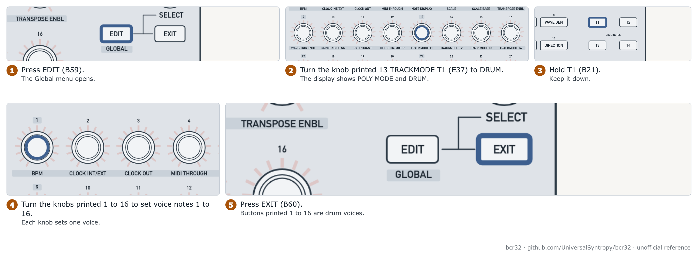
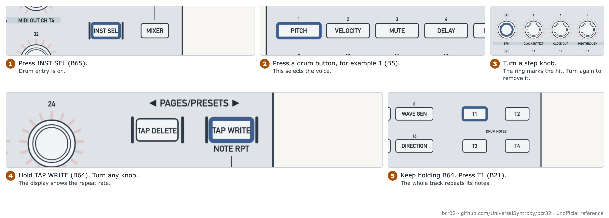

# Program drums and note repeat

Goal: use a track as a drum track with up to 16 voices, and repeat notes.

| Item | Value |
| --- | --- |
| Mode | ZAQ |
| Time | 15 minutes |
| Firmware tested | 1.0.3 for the track mode display. The steps come from the manual and are unverified |

## Step 1: set the track to drum mode

<picture>
  <source media="(prefers-color-scheme: dark)" srcset="../assets/figures/fig-G6-1-drum-track-dark.png">
  
</picture>

**Figure G6-1.** Set a track to drums and set the drum notes. [List of figures](../manual/figures.md)

1. Press the key printed EDIT (B59). The ZAQ Global page opens.
2. Turn the knob for the track: printed 13 to 16 (E37 to E40) are tracks 1 to 4.
3. Set DRUM. The display shows "POLY MODE" with CHORD or DRUM.
4. Press the key printed EXIT (B60).

**Verified:** On our unit E37 (track 1) showed DRUM.

## Step 2: set the voice notes

On a drum track, the buttons printed 1 to 16 (B5 to B20) are drum voices 1 to 16.

1. On the Global page, hold the track button (T1 to T4, B21 to B24).
2. Turn the knobs printed 1 to 16 (E25 to E40) to set the note of voices 1 to 16.
3. The display and the ring show the note. The note also sounds on the outputs of the track.

## Step 3: enter drum steps

<picture>
  <source media="(prefers-color-scheme: dark)" srcset="../assets/figures/fig-G6-2-drum-steps-dark.png">
  
</picture>

**Figure G6-2.** Enter drum hits, and repeat notes. [List of figures](../manual/figures.md)

1. Press the key printed INST SEL (B65).
2. Press a drum button, B5 to B20.
3. Turn the knob of a step to set the hit. Turn again to remove it. The ring marks the steps that have a hit.

**Fill and clear:** hold the drum button and turn any knob clockwise to fill all steps. Turn counter-clockwise to clear all.

**Random:** select a drum button. Hold INST SEL (B65) and press the button printed 8 WAVE GEN (B12). Remove single steps by turning the knob counter-clockwise.

**Velocity:** each step has one velocity. Use it as an accent.

## Step 4: real-time record

1. Press INST SEL (B65).
2. Press the key printed TAP WRITE (B64) to change between MONITOR and RECORD.
3. Play the drum buttons while the sequencer runs.
4. To erase: in RECORD, hold the key printed TAP DELETE (B63) and press the drum button.

## Step 5: the mixer

1. Stop the sequencer. Press the key printed MIXER (B66).
2. Press T1 to T4 (B21 to B24) to mute tracks. Press B5 to B20 to mute drum voices.
3. Green is on. Red is muted.
4. Press MIXER (B66) or EXIT (B60) to leave.

## Step 6: note repeat

1. Hold the key printed TAP WRITE (B64) and turn any knob. The rate list is 96, t32, 32, t16, 16, t8, 8, t4, 4.
2. Still holding B64, press a track button for the whole track. Or press a drum button for one voice.

**Unverified:** We have not tested note repeat on the BCR32. A forum question asks about ratchets on a drum track with one voice. It has no answer.

## Related

- [Sequencer procedures, drum tracks](../manual/07-sequencer-procedures.md)
- [ZAQ Global page](../manual/06-zaq-global-page.md)

**Next step:** Save the pattern. See [save, load and chain patterns](save-load-and-chain-patterns.md).
