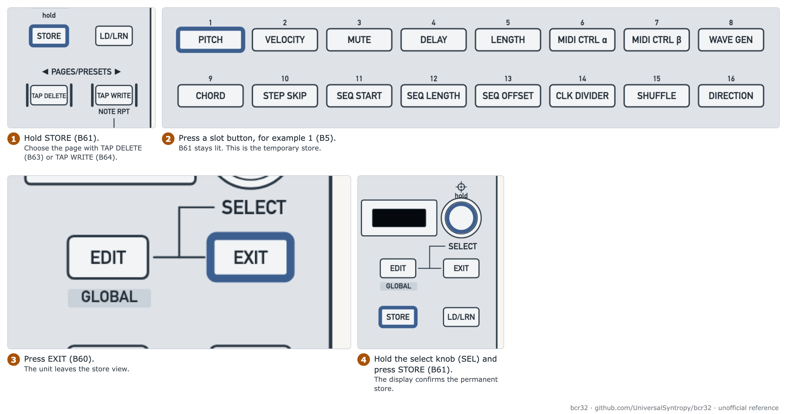

# Save, load and chain patterns

Goal: keep your patterns after power-off, switch between them and play them in order.

| Item | Value |
| --- | --- |
| Mode | ZAQ |
| Time | 10 minutes |
| Firmware tested | 1.0.3 for the display. The steps come from the manual and are unverified |

> **Warning:** A pattern that is not stored permanently is lost at power-off. Nothing loads at power-up. A permanent store overwrites the slot. Check that the slot is empty first. A used slot shows green.

## How the memory is organised

The sequencer has 12 pages. Each page has 16 slots. The buttons printed 1 to 16 (B5 to B20) are slots 1 to 16 of the page that is current.

## Store a pattern

<picture>
  <source media="(prefers-color-scheme: dark)" srcset="../assets/figures/fig-G5-1-store-pattern-dark.png">
  
</picture>

**Figure G5-1.** Store a pattern in permanent memory. [List of figures](../manual/figures.md)

1. Hold the key printed STORE (B61). Keep it down.
2. Choose the page. Press the key printed TAP DELETE (B63) or TAP WRITE (B64). The pages are 1 to 12.
3. Press a slot button, B5 to B20. B61 stays lit. This is the **temporary** store.
4. Press the key printed EXIT (B60).
5. To keep the pattern after power-off: hold the select knob (SEL) and press STORE (B61). The display confirms.

**Expect:** The display confirms the permanent store. Without step 5 the pattern is lost at power-off.

## Load a pattern

1. Press the key printed LD/LRN (B62).
2. Choose the page with B63 or B64.
3. Press the slot button.
4. Press EXIT (B60).

If the sequencer plays, the new pattern starts at the end of the current pattern.

## Chain patterns

Hold one pattern button and press another. The patterns play in order.

**Chain length (unverified):** On the ZAQ Audio forum, the maker says a chain switches when the **slowest track** has played once. The track times depend on the clock divider and the sequence length of each track. If a pattern switches late, check all four tracks. The same answer says to switch off quantize (knob printed 12, E36 on the Global page) for an immediate switch. We have not tested this on the BCR32.

## Copy a track

Hold the destination track button and press the source track button. See the manual for the order of the pattern button. The wording is unclear in the source.

## Footswitch

Footswitch 1 starts and stops the sequencer. Footswitch 2 moves to the next pattern. Both need the ZAQ setting in Global Settings (B9, B10).

## If a pattern is gone

See [troubleshooting](troubleshooting.md#stored-pattern-is-gone-after-power-off).

## Related

- [Sequencer procedures, patterns](../manual/07-sequencer-procedures.md)
- [Back up your BCR32](back-up-your-bcr32.md)

**Next step:** Make a backup. See [back up your BCR32](back-up-your-bcr32.md).
