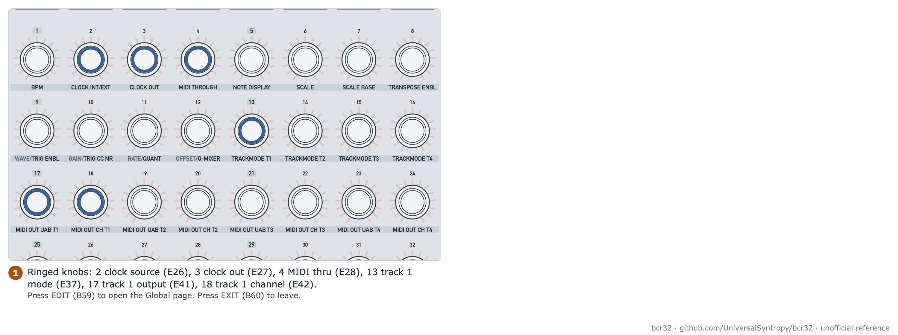

# Set MIDI ports, channels and routing

Goal: send each sequencer track to the right port and channel, and route clock and thru.

| Item | Value |
| --- | --- |
| Mode | ZAQ for tracks and clock; CTRL for controller output |
| Time | 10 minutes |
| Firmware tested | 1.0.3, USB operation mode. DIN ports untested |

## The ports

| Port | Where | Use |
| --- | --- | --- |
| USB, two ports | J70 to the computer | `BCR-32 CTRL` (controller) and `BCR-32 ZAQ` (sequencer) |
| MIDI IN | J71 | Input, 5-pin DIN |
| MIDI OUT A | J72 | Output, 5-pin DIN |
| MIDI OUT B / THRU | J73 | Second output, or thru |

## Step 1: choose the operation mode

The operation mode decides which ports work. It also decides how long the option lists are.

1. Hold the mode button printed ZQR/CTRL (B1) for 3 seconds. The unit opens Global Settings.
2. Press the button printed 3 MUTE (B7). In Global Settings it is the operation mode button. Use the select knob (SEL) to choose. Push SEL to save.
3. Press B1 to leave.

| Mode | DIN MIDI | USB | Internal clock |
| --- | --- | --- | --- |
| USB | off | on | off (manual) |
| STDL | on | off | on |
| MIXED | on | on | on |

**Verified:** In USB mode the list for track 1 output (knob printed 17, E41) shows only three values: U, AB IN and IN. The manual says the full list needs MIXED.

## Step 2: set the output and channel of each track

<picture>
  <source media="(prefers-color-scheme: dark)" srcset="../assets/figures/fig-G2-1-global-routing-knobs-dark.png">
  
</picture>

**Figure G2-1.** Knobs for clock, thru and track output on the Global page. [List of figures](../manual/figures.md)

Open the ZAQ Global page: press the key printed EDIT (B59).

| Track | Output knob (printed, ID) | Channel knob (printed, ID) |
| --- | --- | --- |
| 1 | 17 (E41) | 18 (E42) |
| 2 | 19 (E43) | 20 (E44) |
| 3 | 21 (E45) | 22 (E46) |
| 4 | 23 (E47) | 24 (E48) |

1. Turn the output knob until the display shows the port you want.
2. Turn the channel knob to the channel from 1 to 16.
3. Press the key printed EXIT (B60).

**Output values seen in USB mode (E41):** U (USB), AB IN, IN. In MIXED mode the manual lists the ports USB, MIDI A, MIDI B, the pairs and the triple.

**What IN does:** The value IN is the routing for a track that follows notes from another track. See [lock notes to a scale and transpose](lock-notes-to-a-scale-and-transpose.md). The effect is unverified.

## Step 3: set clock out

The knob printed 3 CLOCK OUT (E27) chooses where the unit sends its clock when the internal clock is the source.

**Values seen in USB mode:** OFF and U. The manual lists OFF, MIDI A, MIDI B, A and B, USB and the combinations.

## Step 4: set MIDI thru

The knob printed 4 MIDI THROUGH (E28) sets the thru source. The display shows both parts, for example "D:OFF THRU SRC MIDI".

1. Turn E28 to choose the **source**: OFF, MIDI or USB (seen on firmware 1.0.3).
2. Push SEL once. The select knob now chooses the **destination**.
3. Turn the **select knob** (not E28) to choose the destination. Push SEL to save.

> **Note:** The manual says the select knob chooses the destination. In our test, turning E28 after the SEL push still changed the source. We have not read the destination list. If the source is OFF, no destination can be used.

**Destinations (manual):** OFF; MIDI A, MIDI B, A and B, USB and the combinations. A filtered version leaves out clock and other messages that the unit makes itself. A filtered destination shows an F.

## Controller output

In CTRL mode, each control sends on the channel that you set in its setup. The controller messages leave on the `BCR-32 CTRL` USB port. Output routing for the controller is in CTRL Settings: hold EDIT (B59), then press STORE (B61). Button 5 chooses the output routing. Button 6 chooses MIDI thru. See [assign controls in CTRL mode](assign-controls-in-ctrl-mode.md).

## Check it works

1. Open a MIDI monitor on the computer.
2. Run the sequencer. See [enter and play your first pattern](enter-and-play-your-first-pattern.md).
3. Check the monitor shows notes on the port and channel that you set.

## Related

- [ZAQ Global page](../manual/06-zaq-global-page.md)
- [MIDI implementation](../manual/16-midi-implementation.md)

**Next step:** Set the clock. See [sync the sequencer to a DAW or hardware](sync-the-sequencer-to-a-daw-or-hardware.md).
