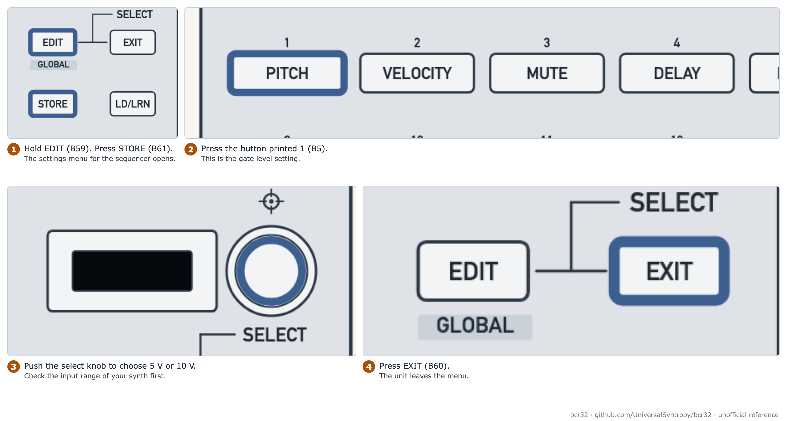
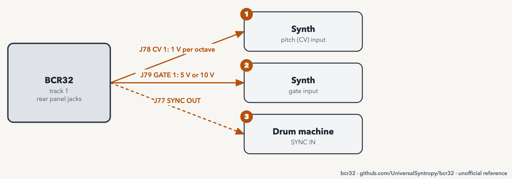

# Use CV and gate with a synth

Goal: play an analog synth from the four sequencer tracks.

| Item | Value |
| --- | --- |
| Mode | ZAQ |
| Needs | 3.5 mm cables, a synth with CV and gate input |
| Time | 15 minutes |
| Firmware tested | 1.0.3. No voltage measurement done. The values come from the manual |

> **Warning:** Check the input range of your synth before you connect. The gate level can be 5 V or 10 V. A wrong level can damage some inputs. See the [disclaimer](../../DISCLAIMER.md).

## The jacks

| Track | CV out | Gate out |
| --- | --- | --- |
| 1 | J78 | J79 |
| 2 | J80 | J81 |
| 3 | J82 | J83 |
| 4 | J84 | J85 |

The physical order is CV1, GATE1, CV2, GATE2, CV3, GATE3, CV4, GATE4. CV is 1 V per octave. The range is 0 to 10 V. See [Rear panel](../manual/04-rear-panel.md).

## Step 1: set the gate level

<picture>
  <source media="(prefers-color-scheme: dark)" srcset="../assets/figures/fig-G12-1-gate-level-dark.png">
  
</picture>

**Figure G12-1.** Set the gate level to 5 V or 10 V. [List of figures](../manual/figures.md)

1. Hold the key printed EDIT (B59). Press the key printed STORE (B61). ZAQ Settings open.
2. Press the button printed 1 (B5). Push the select knob (SEL) to choose 5 V or 10 V.
3. Press the key printed EXIT (B60).

## Step 2: connect

<picture>
  <source media="(prefers-color-scheme: dark)" srcset="../assets/figures/fig-G12-2-cv-gate-wiring-dark.png">
  
</picture>

**Figure G12-2.** CV, gate and sync connections for one synth and one drum machine. [List of figures](../manual/figures.md)

1. Connect the CV jack of the track to the pitch input of the synth.
2. Connect the gate jack of the same track to the gate input.
3. Set the track to chord mode. See [enter and play your first pattern](enter-and-play-your-first-pattern.md).

## Step 3: tune

All steps start at C3. Play one step. Tune the synth to C3. Warm up analog gear first.

To move all notes together, hold the button printed 1 PITCH (B5) and turn one knob.

## Step 4: calibrate (only if the tuning is off)

The unit is factory calibrated. Calibrate only when the pitch does not track over the range. You need a millivolt meter.

1. Hold the mode button (B1) for 3 seconds. Press the button printed 4 DELAY (B8). The display shows MIN.
2. Put the meter on the CV jack of the track.
3. Follow the steps in [CV calibration](../manual/09-global-sync-memory-and-maintenance.md#94-cv-calibration-factory-calibrated-only-if-needed).

## Sync and drum machines

J77 SYNC OUT sends clock and start/stop. See [sync the sequencer to a DAW or hardware](sync-the-sequencer-to-a-daw-or-hardware.md).

## Related

- [Rear panel](../manual/04-rear-panel.md)
- [ZAQ Settings](../manual/09-global-sync-memory-and-maintenance.md)

**Next step:** Enter a pattern. See [enter and play your first pattern](enter-and-play-your-first-pattern.md).
