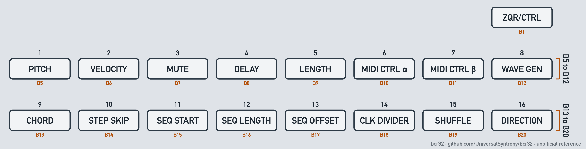
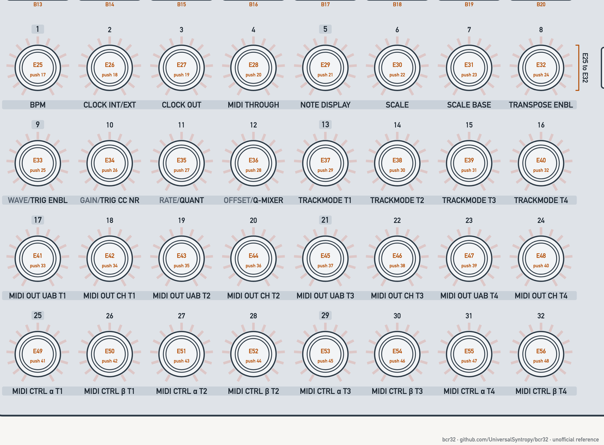
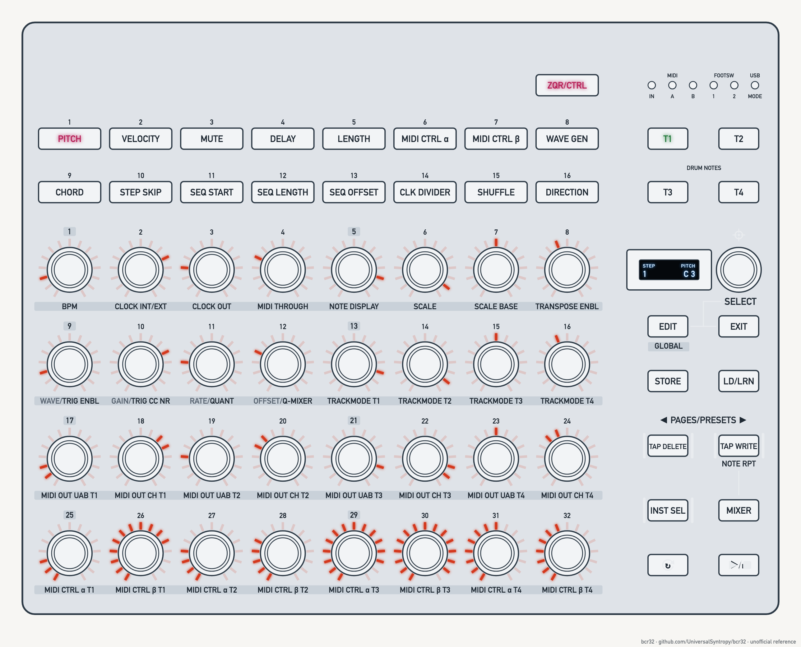
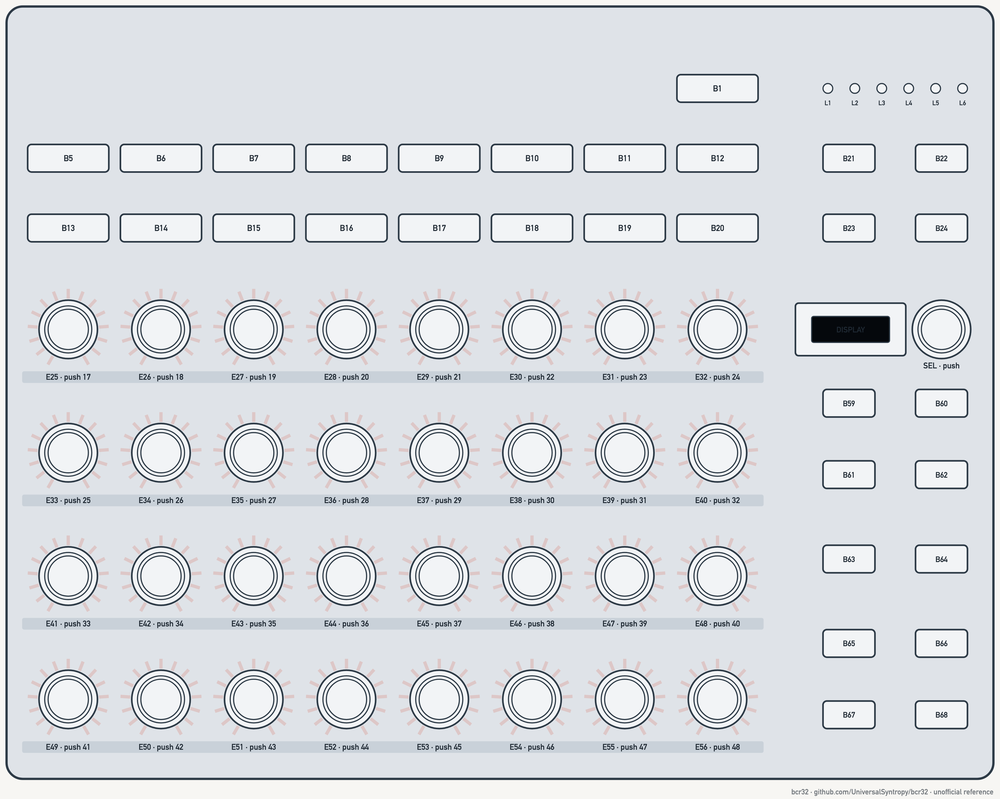

# 3. Top panel — control map

Layout is a grid. Coordinates `(row, col)` are for diagram use; row 0 is the top.

## 3.1 Left block: parameter buttons (B5–B20)

<a id="fig-3-3"></a>
<picture>
  <source media="(prefers-color-scheme: dark)" srcset="../assets/figures/fig-3-3-parameter-buttons-dark.png">
  
</picture>

**Figure 3-3.** Parameter buttons B5 to B20 and the mode button B1. [List of figures](figures.md)

| ID | Panel no. | Label | Pos | ZAQ meaning (§5) | [Global Settings](13-glossary.md#global-settings) | [ZAQ Settings](13-glossary.md#zaq-settings) | [CTRL Settings](13-glossary.md#ctrl-settings) |
| --- | --- | --- | --- | --- | --- | --- | --- |
| B5 | 1 | PITCH | (0,0) | Note pitch per [step](13-glossary.md#step) | Device mode | [Gate](13-glossary.md#gate) out 5/10 V | Output routing |
| B6 | 2 | VELOCITY | (0,1) | Velocity | Device ID | Sync in clock | [MIDI thru](13-glossary.md#midi-thru) |
| B7 | 3 | MUTE | (0,2) | Step mute | [Operation mode](13-glossary.md#operation-mode) | Sync out clock | — |
| B8 | 4 | DELAY | (0,3) | Micro-timing −5…+5 | CV1 measure (calibration) | Sync in start | — |
| B9 | 5 | LENGTH | (0,4) | Note length | [Footswitch](13-glossary.md#footswitch) 1 | — | — |
| B10 | 6 | MIDI CTRL α | (0,5) | α [control lane](13-glossary.md#control-lane) | Footswitch 2 | — | — |
| B11 | 7 | MIDI CTRL β | (0,6) | β control lane | [Firmware](13-glossary.md#firmware) version | — | — |
| B12 | 8 | WAVE GEN | (0,7) | [Wave generator](13-glossary.md#wave-generator) | [Factory restore](13-glossary.md#factory-restore) | — | — |
| B13 | 9 | [CHORD](13-glossary.md#chord) | (1,0) | Chord per step | — | — | — |
| B14 | 10 | STEP SKIP | (1,1) | Skip per step | — | — | — |
| B15 | 11 | SEQ START | (1,2) | Start step | — | — | — |
| B16 | 12 | SEQ LENGTH | (1,3) | Length 1–32 | — | — | — |
| B17 | 13 | SEQ OFFSET | (1,4) | Offset 0–31 | — | — | — |
| B18 | 14 | CLK DIVIDER | (1,5) | Clock division | — | — | — |
| B19 | 15 | [SHUFFLE](13-glossary.md#shuffle) | (1,6) | Shuffle | — | — | — |
| B20 | 16 | DIRECTION | (1,7) | Play direction | — | — | — |

Other roles of B5–B20:

- **[Drum voices](13-glossary.md#drum-voice):** on a [drum track](13-glossary.md#drum-track), B5–B20 = drum voices 1–16.
- **[Pattern](13-glossary.md#pattern) [slots](13-glossary.md#slot):** in STORE / LOAD, B5–B20 = slots 1–16 of the current [page](13-glossary.md#page). Green = slot used. Flashing = current pattern.
- **Virtual keyboard (real-time note entry):** piano layout. Black keys = B6, B7, B9, B10, B11 (C#, D#, F#, G#, A#). White keys = B13–B20 (C, D, E, F, G, A, B, C). B5, B8, B12 not used. Key-to-note mapping is inferred from the layout; the source only lists the buttons.
- **Number pad ([CV](13-glossary.md#cv) calibration):** B5–B14 = digits, B15 = +, B16 = −, B19 = clear, B20 = backspace. The source does not say which button is which digit.
- **[CTRL mode](13-glossary.md#ctrl-mode):** B5–B24 are assignable.

## 3.2 Track buttons and status LEDs

| ID | Label | Pos | Function |
| --- | --- | --- | --- |
| B1 | ZQR/CTRL | above B12 | Mode toggle; `×3s` = Global Settings |
| B21 | T1 | (0,8) | Select [track](13-glossary.md#track) 1 |
| B22 | T2 | (0,9) | Select track 2 |
| B23 | T3 | (1,8) | Select track 3 |
| B24 | T4 | (1,9) | Select track 4 |
| L2 | MIDI IN / A / B | top right | MIDI activity |
| L3 | FOOTSW 1 / 2 | top right | Flash on footswitch use |
| L4 | USB MODE | top right | USB activity |

Track buttons: current track flashes; green = playing, red = muted in [mixer](13-glossary.md#mixer). Only one track is selected for editing. A small "DRUM NOTES" legend sits between the T rows.

## 3.3 Encoder grid (E25–E56)

<a id="fig-3-4"></a>
<picture>
  <source media="(prefers-color-scheme: dark)" srcset="../assets/figures/fig-3-4-knob-grid-dark.png">
  
</picture>

**Figure 3-4.** Knob grid E25 to E56 with the printed numbers 1 to 32. [List of figures](figures.md)

Each [encoder](13-glossary.md#encoder): push switch + LED ring. The step number (1–32) is printed above it. Steps 1, 5, 9 … 29 are boxed as beat markers. The label printed below is its ZAQ Global function (§6).

| Row | Encoders | Steps | Labels below (ZAQ Global) |
| --- | --- | --- | --- |
| 2 | E25–E32 | 1–8 | [BPM](13-glossary.md#bpm) · CLOCK INT/EXT · CLOCK OUT · MIDI THROUGH · NOTE [DISPLAY](13-glossary.md#display-disp) · [SCALE](13-glossary.md#scale) · SCALE BASE · [TRANSPOSE](13-glossary.md#transpose) ENBL |
| 3 | E33–E40 | 9–16 | WAVE/TRIG ENBL · GAIN/TRIG [CC](13-glossary.md#control-change-cc) NR · RATE/QUANT · OFFSET/Q-MIXER · TRACKMODE T1 · T2 · T3 · T4 |
| 4 | E41–E48 | 17–24 | MIDI OUT UAB T1 · MIDI OUT CH T1 · UAB T2 · CH T2 · UAB T3 · CH T3 · UAB T4 · CH T4 |
| 5 | E49–E56 | 25–32 | MIDI CTRL α T1 · β T1 · α T2 · β T2 · α T3 · β T3 · α T4 · β T4 |

Row 3 split labels: the first half (WAVE, GAIN, RATE, OFFSET) is the Wave Gen parameter while B12 is held. The second half is the Global function. "UAB" = USB / MIDI A / MIDI B routing.

## 3.4 Right block

| ID | Label | Pos (row, col in block) | ZAQ | CTRL |
| --- | --- | --- | --- | --- |
| DISP | display | (0,0) | parameter/value | parameter/value |
| [SEL](13-glossary.md#select-encoder-sel) (58) | SELECT | (0,1) | turn = value, push = enter/confirm | same |
| B59 | EDIT / GLOBAL | (1,0) | Global page; hold + encoder = edit all steps | hold = assign controls |
| B60 | EXIT | (1,1) | leave STORE/LOAD/GLOBAL | leave EDIT/STORE/LOAD |
| B61 | STORE | (2,0) | store pattern | store [preset](13-glossary.md#preset) |
| B62 | LD/LRN | (2,1) | LOAD pattern | [LEARN](13-glossary.md#learn) |
| B63 | TAP DELETE / ◄ | (3,0) | erase in real-time rec; page down; hold = peek global value | previous preset/location; previous setup option |
| B64 | TAP WRITE / ► / NOTE RPT | (3,1) | rec sub-mode; page up; in Mixer = [note repeat](13-glossary.md#note-repeat) | next preset/location; next setup option |
| B65 | INST SEL | (4,0) | real-time programming on/off | assignable |
| B66 | MIXER | (4,1) | mixer | assignable |
| B67 | RESET (↻) | (5,0) | jump to step 1 | assignable |
| B68 | PLAY/STOP | (5,1) | start/stop | assignable |

The label "◄ PAGES/PRESETS ►" sits above B63/B64.

## 3.5 Diagram of the top panel

<a id="fig-3-1"></a>
<picture>
  <source media="(prefers-color-scheme: dark)" srcset="../assets/figures/fig-3-1-hero-dark.png">
  
</picture>

**Figure 3-1.** The BCR32 top panel with PITCH selected. [List of figures](figures.md)

<a id="fig-3-2"></a>
<picture>
  <source media="(prefers-color-scheme: dark)" srcset="../assets/figures/fig-3-2-top-panel-ids-dark.png">
  
</picture>

**Figure 3-2.** Top panel with the ID of every control. [List of figures](figures.md)

This is our own drawing of the top panel, seen from above. Each cell is a [control ID](13-glossary.md#control-id). The number in a control ID is its [callout](13-glossary.md#callout) number, except for the LEDs: L2 has three LEDs, L3 has two and L4 has one. The drawing shows order and grouping. It does not show true sizes or spacing.

```text
                             B1                   L2.in L2.a L2.b L3.1 L3.2 L4

 B5  B6  B7  B8  B9  B10 B11 B12                  B21  B22
 B13 B14 B15 B16 B17 B18 B19 B20                  B23  B24

 E25 E26 E27 E28 E29 E30 E31 E32                  DISP SEL
 E33 E34 E35 E36 E37 E38 E39 E40                  B59  B60
 E41 E42 E43 E44 E45 E46 E47 E48                  B61  B62
 E49 E50 E51 E52 E53 E54 E55 E56                  B63  B64
                                                  B65  B66
                                                  B67  B68
```

| Area | Controls | Details |
| --- | --- | --- |
| Parameter buttons | `B5`–`B20` | two rows of eight, section 3.1 |
| Mode button | `B1` | above the parameter buttons, at the right, section 3.2 |
| Status LEDs | `L2.in`, `L2.a`, `L2.b`, `L3.1`, `L3.2`, `L4` | top right, section 3.2 |
| Track buttons | `B21`–`B24` | two rows of two, section 3.2 |
| Encoder grid | `E25`–`E56` | four rows of eight, section 3.3 |
| Right block | `DISP`, `SEL`, `B59`–`B68` | six rows of two, section 3.4 |

A photo of the top panel from the unit session on firmware 1.0.3 shows this order (see the [findings](../reference/capture-findings.md#results)). The photos stay local.
